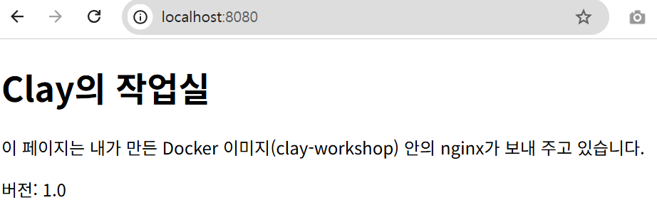
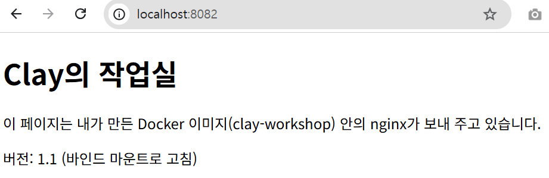
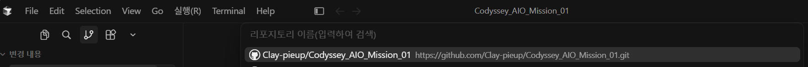

# Mission 01 학습 기록

[README로 돌아가기](README.md)

## 목차
- [설계 결정](#설계-결정)
- [핵심 코드 해설](#핵심-코드-해설)
- [수행 로그](#수행-로그)
- [시행착오](#시행착오)
- [배운 점](#배운-점)
- [용어 사전](#용어-사전)

## 설계 결정

### 1. 작업 환경은 WSL2(Ubuntu) + Docker Desktop
- 맥락: 내 PC는 Windows다. 명세는 리눅스 터미널로 실습하라고 하고, 명세의 OrbStack 안내는 서울캠퍼스(Mac)용이다.
- 결정: Windows 안에서 리눅스(Ubuntu)를 돌리는 WSL2를 쓰고, Docker Desktop을 WSL 2 백엔드로 연결했다 (사용자 단위 설치, Ubuntu WSL integration 켬).
- 결과: 얻은 것: 명세 예시와 같은 Ubuntu bash에서 실습할 수 있다. / 포기한 것: 설치 단계가 늘고, Windows와 Ubuntu 두 환경을 구분해야 한다.

### 2. 편집기는 VSCode 대신 Cursor
- 맥락: 명세는 VSCode에서 GitHub 로그인·저장소 연동 증거를 요구한다. 나는 평소 Cursor를 쓴다.
- 결정: Cursor로 연동 증거를 남긴다. Cursor는 VSCode를 바탕으로 만든 편집기라 GitHub 로그인·저장소 연동 기능이 같다.
- 결과: 얻은 것: 익숙한 도구로 작업한다. / 포기한 것: 명세와 이름이 달라서 평가자에게 대체 이유를 설명해야 한다.

### 3. 브랜치는 main 하나만 쓴다
- 맥락: 명세에 브랜치를 만들라는 요구가 없고, 혼자 하는 실습이다. 처음에는 작업 브랜치(`mission01`)를 따로 두려 했다.
- 결정: 작업 브랜치 없이 `main`에서 바로 작업·커밋·push한다. 만들었던 빈 `mission01` 브랜치는 지웠다.
- 결과: 얻은 것: 절차가 단순하고, 평가 요청 때 브랜치 이름을 헷갈리지 않는다. / 포기한 것: 실험하다 망가뜨려도 되는 별도 공간.

### 4. Git은 PowerShell, 실습은 Ubuntu bash
- 맥락: Git 사용자 정보(이름, noreply 이메일, 기본 브랜치)가 Windows 쪽에 이미 설정돼 있고, Mission 03에서 PowerShell로 커밋해 봤다. 명세 예시는 Ubuntu bash다. Windows와 Ubuntu는 Git 설정을 따로 가진다.
- 결정: git 명령(설정·커밋·push)은 PowerShell에서, 터미널·권한·Docker 실습은 Ubuntu bash에서 한다.
- 결과: 얻은 것: Git 설정을 다시 하지 않고 익숙한 방식으로 커밋한다. / 포기한 것: 두 터미널을 오가야 하고, README 실행 환경에 둘을 나눠 적어야 한다. Ubuntu에서 git을 쓰면 이름·이메일이 다르게 찍힐 수 있으니 git은 PowerShell에서만 쓴다.

### 5. 로그는 LEARNING.md, 스크린샷은 images/
- 맥락: README는 100줄 안에서 1~2분에 읽혀야 하는데, 명세가 요구하는 명령+출력은 양이 많다. 명세는 별도 파일도 README에서 링크로 갈 수 있으면 된다고 한다.
- 결정: 명령+출력은 이 파일 '수행 로그'에, 스크린샷은 `images/` 폴더에 두고, README에는 요약과 링크만 둔다.
- 결과: 얻은 것: README가 짧고 읽기 쉽다. / 포기한 것: 증거를 보려면 링크를 한 번 더 눌러야 한다.

### 6. GitHub에 빈 저장소를 만들고 clone
- 맥락: GitHub에서 README나 .gitignore를 함께 만들면, 내 PC에서 만든 파일과 기록이 어긋나 첫 push에서 충돌이 날 수 있다.
- 결정: 체크 항목 없이 Public 빈 저장소를 만들고, `git clone`으로 내 PC에 가져왔다.
- 결과: 얻은 것: GitHub 연결 정보(origin)가 자동으로 설정된다. / 포기한 것: clone할 때 '빈 저장소' 경고가 뜬다 (정상).

### 7. 실습은 저장소 밖 `~/workshop`에서 한다
- 맥락: 터미널 조작·권한 실습은 파일을 만들고 지우는 연습이다. 저장소 폴더에서 하면 연습 파일이 커밋에 섞일 수 있다.
- 결정: Ubuntu 홈 폴더의 `~/workshop`에서 실습하고, 명령+출력만 이 파일 '수행 로그'에 옮긴다. 명세 예시 경로(`~/codyssey/practice`)는 그대로 쓰지 않았다.
- 결과: 얻은 것: 저장소에는 결과 기록만 깔끔하게 남는다. / 포기한 것: 실습 폴더 자체는 GitHub에 없어서 로그로만 증명한다.

### 8. 커스텀 이미지는 nginx + 내 웹 페이지로 만든다 (명세 방식 A)
- 맥락: 명세는 (A) 웹 서버 베이스 + 콘텐츠·설정 교체, (B) 리눅스 베이스 + 기능 추가 중 하나를 고르라고 한다. 이 이미지는 U8 포트 매핑·바인드 마운트, U9 볼륨까지 이어서 쓴다.
- 결정: `nginx:1.27-alpine`을 베이스로, 내 웹 페이지와 내가 쓴 nginx 설정을 넣는다. 명세 예시(`LABEL`+`ENV`+`COPY site/`)와 겹치지 않게 포트 변경(80→8080), 응답 헤더, 헬스체크를 커스텀 포인트로 잡았다.
- 결과: 얻은 것: 코드가 짧아 줄마다 설명할 수 있고, HTML만 고쳐 바로 바뀌는 것을 보여 줄 수 있다. / 포기한 것: Python 웹 서버(②)의 프로그래밍 연습, 리눅스 기능 추가(③)는 하지 않았다. ③은 웹 서버가 아니라서 U8과 이어지지 않았다.

### 9. `app/`·`conf/`를 나누고 `.dockerignore`로 CLAUDE.md를 막는다
- 맥락: 웹 페이지 폴더에 설정 파일이 섞이면 손님이 설정을 내려받을 수 있다. 또 `docker build .`는 폴더 전체를 Docker에 보내는데, 이 폴더에는 공개하면 안 되는 CLAUDE.md가 있다.
- 결정: 보여 줄 파일은 `app/`, nginx 설정은 `conf/`에 두고 각각 다른 곳으로 COPY한다. `.dockerignore`로 `.git`·`CLAUDE.md`·`*.md`·`*.pdf`를 빌드에 보내지 않는다.
- 결과: 얻은 것: 빌드에 보낸 크기가 687B뿐이었다(CLAUDE.md 약 30KB 차단). / 포기한 것: 파일이 하나 더(.dockerignore) 늘었다.

### 10. 바인드 마운트는 저장소 원본이 아니라 복사본에 건다
- 맥락: 바인드 마운트를 확인하려면 내 PC 쪽 파일을 고쳐야 한다. 저장소의 `app/index.html`을 직접 고치면 실습 때문에 커밋된 파일이 바뀐다. 또 `/mnt/c`(Windows 폴더)보다 Ubuntu 홈 폴더가 Docker에서 더 빠르다.
- 결정: `app/`을 `~/workshop/site`로 복사하고, 그 복사본을 컨테이너의 웹 폴더에 연결해 고쳤다.
- 결과: 얻은 것: 저장소 파일은 그대로이고, 이미지 그대로인 컨테이너(8080)와 마운트한 컨테이너(8082)를 나란히 비교할 수 있었다. / 포기한 것: 복사 단계가 하나 늘었다.

## 핵심 코드 해설

<details><summary>.gitignore — 저장소에 올리지 않을 파일 목록</summary>

```gitignore
CLAUDE.md          # 작업 기준 파일. 교육자료 내용이 들어 있어 공개하면 안 된다
*.pdf              # 모든 PDF (미션 명세 PDF가 실수로 들어와도 막는다)
Mission_*.md       # 미션 명세 md 변환본
.env               # 토큰·비밀번호를 담는 파일
id_*               # SSH 키 파일 (보너스 5에서 만든다. 개인키는 절대 공개 금지)
*.pem              # 인증서·키 파일
Thumbs.db          # Windows가 사진 미리보기용으로 자동으로 만드는 파일
desktop.ini        # Windows가 폴더 설정용으로 자동으로 만드는 파일
```
- 위 블록은 해설용으로 줄 끝에 설명을 붙였다. 실제 `.gitignore`는 같은 줄 뒤의 `#`을 설명으로 알아보지 못해서, 설명을 윗줄에 따로 적었다.
- `*`는 '아무 글자나'라는 뜻이다. `*.pdf`는 이름이 무엇이든 끝이 `.pdf`인 파일 전부다.
- 여기 적힌 파일은 `git add .`를 해도 커밋 대상에 들어가지 않는다.

</details>

<details><summary>Dockerfile — 이미지를 만드는 설계도</summary>

```dockerfile
FROM nginx:1.27-alpine
LABEL org.opencontainers.image.title="clay-workshop" \
      org.opencontainers.image.description="Codyssey Mission 01 custom nginx image"
COPY conf/default.conf /etc/nginx/conf.d/default.conf
COPY app/ /usr/share/nginx/html/
EXPOSE 8080
HEALTHCHECK --interval=10s --timeout=3s --retries=3 \
  CMD wget -qO- http://127.0.0.1:8080/health || exit 1
```
- `FROM nginx:1.27-alpine`: 기존 이미지(nginx 웹 서버 + 작은 리눅스 alpine)를 바탕으로 시작한다. 버전을 1.27로 고정해 누가 빌드해도 같은 nginx가 들어간다(재현성).
- `LABEL …`: 이미지에 이름표(설명)를 붙인다. 실행에는 영향이 없다. `\`는 다음 줄에 이어진다는 뜻이다.
- `COPY conf/default.conf …`: nginx 기본 설정을 내 설정으로 바꿔치기한다.
- `COPY app/ …`: 기본 환영 페이지 자리에 내 페이지를 넣는다.
- `EXPOSE 8080`: "8080번 문으로 손님을 받는다"는 안내 표시다. 이것만으로 밖에서 접속되지는 않고, 밖과 잇는 일은 `docker run -p`가 한다(U8).
- `HEALTHCHECK …`: Docker가 10초마다 컨테이너 안에서 `/health`를 열어 본다. 3초 안에 답이 없거나 3번 연속 실패하면 `unhealthy`. `|| exit 1`은 실패하면 실패 신호(1)를 보내라는 뜻이다.

</details>

<details><summary>conf/default.conf — nginx가 손님을 받는 방법</summary>

```nginx
server {
    listen 8080;                                  # 기본 80번 대신 8080번 문으로 받는다
    root  /usr/share/nginx/html;                  # 웹 페이지 파일이 있는 폴더
    index index.html;                             # 주소만 치면 index.html을 보여 준다
    add_header X-Workshop "clay-m01" always;      # 모든 응답에 '내가 만든 서버' 표시를 붙인다
    location / { try_files $uri $uri/ =404; }     # 요청한 파일이 있으면 주고, 없으면 404
    location = /health { return 200 "ok\n"; }     # /health는 파일 없이 바로 "ok"로 답한다 (헬스체크용)
}
```
(해설용으로 줄을 합치고 `#` 설명을 붙였다. 실제 파일은 줄을 나눠 썼다.)

</details>

<details><summary>app/index.html · .dockerignore</summary>

- `app/index.html`: 제목 'Clay의 작업실'과 '이 페이지는 내가 만든 Docker 이미지(clay-workshop) 안의 nginx가 보내 주고 있습니다', '버전: 1.0'을 보여 주는 한 장짜리 페이지. U8에서 이 파일을 바꿔 바인드 마운트를 확인한다.
- `.dockerignore`: `docker build .`가 Docker에 보내지 않을 파일 목록. `.git`, `CLAUDE.md`, `*.md`, `*.pdf`를 막아 공개하면 안 되는 파일이 이미지에 섞이지 않게 한다.

</details>

**커스텀 포인트와 목적**
| 커스텀 포인트 | 목적 | 확인 (U7 수행 로그) |
|---|---|---|
| 기본 환영 페이지 → 내 `index.html` | 내 이미지가 보내는 페이지인지 눈으로 확인 | 'Clay의 작업실' 페이지가 옴 |
| 포트 80 → 8080 (`listen 8080`) | 컨테이너 안 포트와 내 PC 포트가 달라도 되는 것을 U8에서 보여 주기 | 8080으로 요청해 200 OK |
| 응답 헤더 `X-Workshop: clay-m01` | 응답이 기본 nginx가 아니라 내 설정에서 왔다는 증거 | 헤더에 `X-Workshop: clay-m01` |
| `/health` + `HEALTHCHECK` | 컨테이너가 실제로 일하는지 Docker가 스스로 확인 | `ok`, `(healthy)` |
| 버전 고정 + `LABEL` | 다시 빌드해도 같은 결과, 이미지 설명 붙이기 | Labels에 title·description |

## 수행 로그

### U1 · 작업 환경 준비
- WSL2(Ubuntu)와 Docker Desktop(Docker 29.9.3)을 설치했다. `docker --version`·`docker info`의 명령+출력은 U5에서 기록한다.

### U2 · Git 설정·저장소 만들기
```
PS> git --version                          → git version 2.54.0.windows.1
PS> git config --global user.name          → Clay-pieup
PS> git config --global user.email         → (GitHub noreply 주소, 공개 저장소라 가림)
PS> git config --global init.defaultBranch → main
(GitHub에서 Public 빈 저장소 Codyssey_AIO_Mission_01 생성)
PS> git clone https://github.com/Clay-pieup/Codyssey_AIO_Mission_01.git
Cloning into 'Codyssey_AIO_Mission_01'...
warning: You appear to have cloned an empty repository.
PS> cd Codyssey_AIO_Mission_01
PS> git status
On branch main

No commits yet

nothing to commit (create/copy files and use "git add" to track)
(.gitignore·README.md·LEARNING.md 작성, CLAUDE.md를 저장소 폴더로 이동)
PS> git add .
warning: in the working copy of '.gitignore', LF will be replaced by CRLF the next time Git touches it
(LEARNING.md·README.md도 같은 경고 → 시행착오 2)
PS> git status
Changes to be committed:
        new file:   .gitignore
        new file:   LEARNING.md
        new file:   README.md
→ CLAUDE.md가 목록에 없음 = .gitignore가 제대로 막고 있음
PS> git commit -m "Docs: 저장소 뼈대 추가 - README·LEARNING·.gitignore로 Mission 01 작업 시작 준비"
PS> git push -u origin main
→ GitHub에 커밋 a40353e·파일 3개·README 표시 확인
```

`git config --list` (명세 4-10, 발췌 · 이메일은 가림)
```
PS> git config --list
(system 설정 — Git 설치 때 생김)
core.autocrlf=true
credential.helper=manager
init.defaultbranch=master
(global 설정 — 내 계정 전체)
user.name=Clay-pieup
user.email=(GitHub noreply 주소, 가림)
init.defaultbranch=main
core.editor=cursor --wait
(local 설정 — 이 저장소만)
remote.origin.url=https://github.com/Clay-pieup/Codyssey_AIO_Mission_01.git
branch.main.remote=origin
branch.main.merge=refs/heads/main
```

브랜치 정리 (설계 결정 3)
```
PS> git checkout -b mission01      → Switched to a new branch 'mission01'
PS> git checkout main              → Switched to branch 'main' / Your branch is up to date with 'origin/main'.
PS> git branch -d mission01        → Deleted branch mission01 (was a40353e).
```

### U3 · 터미널 조작 로그
Ubuntu bash에서 실행했다. 여러 줄을 한꺼번에 붙여 넣어 출력이 끝에 모여 나왔기 때문에, 명령 순서대로 출력을 짝지어 정리했다. 실습 폴더는 저장소 밖 `~/workshop`이다 (설계 결정 7).
```
$ cd ~
$ pwd                                  → /home/clay
$ mkdir -p workshop/notes
$ cd workshop
$ pwd                                  → /home/clay/workshop
$ echo "hello codyssey" > notes/hello.txt
$ cat notes/hello.txt                  → hello codyssey
$ touch empty.txt
$ touch .secret_memo
$ ls                                   → empty.txt  notes        (숨김 파일 안 보임)
$ ls -la
total 12
drwxr-xr-x 3 clay clay 4096 Nov 25 18:30 .
drwxr-x--- 7 clay clay 4096 Nov 25 18:30 ..
-rw-r--r-- 1 clay clay    0 Nov 25 18:30 .secret_memo   ← -a로 숨김 파일이 보임
-rw-r--r-- 1 clay clay    0 Nov 25 18:30 empty.txt      ← 크기 0 = 빈 파일
drwxr-xr-x 2 clay clay 4096 Nov 25 18:30 notes
$ cp notes/hello.txt hello_copy.txt
$ mv hello_copy.txt hello_renamed.txt
$ mkdir backup
$ mv hello_renamed.txt backup/
$ ls -la backup
total 12
drwxr-xr-x 2 clay clay 4096 Nov 25 18:30 .
drwxr-xr-x 4 clay clay 4096 Nov 25 18:30 ..
-rw-r--r-- 1 clay clay   15 Nov 25 18:30 hello_renamed.txt   ← 복사·이름변경·이동 확인
$ cd notes ; pwd                       → /home/clay/workshop/notes   (상대 경로)
$ cd .. ; pwd                          → /home/clay/workshop         (상대 경로, 한 단계 위)
$ cd /tmp ; pwd                        → /tmp                        (절대 경로)
$ cd ~/workshop ; pwd                  → /home/clay/workshop         (~ = /home/clay)
$ rm backup/hello_renamed.txt
$ rmdir backup
$ ls -la
total 12
drwxr-xr-x 3 clay clay 4096 Nov 25 18:30 .
drwxr-x--- 7 clay clay 4096 Nov 25 18:30 ..
-rw-r--r-- 1 clay clay    0 Nov 25 18:30 .secret_memo
-rw-r--r-- 1 clay clay    0 Nov 25 18:30 empty.txt
drwxr-xr-x 2 clay clay 4096 Nov 25 18:30 notes            ← backup 사라짐 = 삭제 확인
```
- 참고: Ubuntu 터미널은 처음에 `/mnt/c/Users/…`에서 열렸다. Windows의 C 드라이브가 Ubuntu에서는 `/mnt/c`라는 절대 경로로 보인다.

### U4 · 권한 실습
Ubuntu bash에서 `bash -x`로 실행했다. 명령 앞의 `+` 줄은 bash가 실행 직전에 찍은 명령이다 (시행착오 3).
```
$ bash -x <<'EOF' … EOF
+ stat -c '%a %A %n' empty.txt notes
644 -rw-r--r-- empty.txt                ← 파일 변경 전
755 drwxr-xr-x notes                    ← 폴더 변경 전
+ chmod 755 empty.txt
+ stat -c '%a %A %n' empty.txt
755 -rwxr-xr-x empty.txt                ← 파일 변경 후 (주인·그룹·나머지에 x 추가)
+ chmod 000 empty.txt
+ cat empty.txt
cat: empty.txt: Permission denied       ← r이 없으면 주인도 못 읽음
+ chmod 644 empty.txt
+ stat -c '%a %A %n' empty.txt
644 -rw-r--r-- empty.txt                ← 원래대로
+ chmod 700 notes
+ stat -c '%a %A %n' notes
700 drwx------ notes                    ← 폴더 변경 후 (주인만 접근)
+ chmod 600 notes
+ cd notes
bash: line 12: cd: notes: Permission denied   ← 폴더는 x가 있어야 들어갈 수 있음
+ chmod 755 notes
+ stat -c '%a %A %n' notes
755 drwxr-xr-x notes                    ← 원래대로
```

| 대상 | 변경 전 | 변경 후 | 효과 확인 |
|---|---|---|---|
| 파일 `empty.txt` | 644 `-rw-r--r--` | 755 `-rwxr-xr-x` | 000으로 막자 `cat` 거부 → 644로 복구 |
| 폴더 `notes` | 755 `drwxr-xr-x` | 700 `drwx------` | 600(x 없음)으로 바꾸자 `cd` 거부 → 755로 복구 |

### U5 · Docker 점검·기본 운영 명령
docker 명령은 입력 통로를 가져가서(시행착오 4), 명령을 스크립트 파일 `~/workshop/u5.sh`에 저장한 뒤 `bash -x ~/workshop/u5.sh`로 실행했다. 먼저 Ubuntu에서 Docker 엔진에 연결되는지 확인했다(시행착오 5).
```
$ which -a docker
/usr/bin/docker                      ← Ubuntu용 docker가 맨 위 (WSL integration 켠 뒤)
/bin/docker
/Docker/host/bin/docker
$ docker info --format 'Server: {{.ServerVersion}} / OS: {{.OperatingSystem}}'
Server: 29.9.3 / OS: Docker Desktop

$ bash -x ~/workshop/u5.sh
+ docker --version
Docker version 29.9.3, build 5457199
+ docker info | grep -E 'Server Version|Operating System|Containers:|Running:|Stopped:|Images:|CPUs|Total Memory'
 Containers: 0
  Running: 0
  Stopped: 0
 Images: 0
 Server Version: 29.9.3
 Operating System: Docker Desktop
 CPUs: 14
 Total Memory: 15.36GiB                ← 엔진(데몬)이 응답함 = 동작 중
+ docker run hello-world
Unable to find image 'hello-world:latest' locally
latest: Pulling from library/hello-world
Status: Downloaded newer image for hello-world:latest

Hello from Docker!
This message shows that your installation appears to be working correctly.
(안내문 4단계: 클라이언트가 데몬에 연락 → 데몬이 Docker Hub에서 이미지를 받음
 → 이미지로 컨테이너를 만들어 실행 → 출력을 내 터미널로 보냄)
+ docker pull alpine:3.20
3.20: Pulling from library/alpine
Status: Downloaded newer image for alpine:3.20
docker.io/library/alpine:3.20
+ docker images
IMAGE               ID             DISK USAGE   CONTENT SIZE   EXTRA
alpine:3.20         d9e853e87e55       12.2MB         3.71MB
hello-world:latest  1e4c05b897a7       25.9kB         9.49kB    U   ← U = 이 이미지로 만든 컨테이너가 있음
+ docker run -d --name u5-ticker alpine:3.20 sh -c 'i=1; while true; do echo "tick $i"; i=$((i+1)); sleep 2; done'
f64ca20dbca5f7bc01e332e65ea140862db8755de68f8e6a773fc8e0cedcc2fa   ← 컨테이너 ID
+ sleep 7
+ docker ps
CONTAINER ID   IMAGE         COMMAND                  CREATED         STATUS         PORTS     NAMES
f64ca20dbca5   alpine:3.20   "sh -c 'i=1; while t…"   7 seconds ago   Up 7 seconds             u5-ticker
+ docker logs u5-ticker
tick 1
tick 2
tick 3
tick 4
+ docker stats --no-stream u5-ticker
CONTAINER ID   NAME        CPU %     MEM USAGE / LIMIT     MEM %     NET I/O          BLOCK I/O   PIDS
f64ca20dbca5   u5-ticker   0.10%     1.734MiB / 15.36GiB   0.01%     1.17kB / 126B    0B / 0B     2
+ docker stop u5-ticker
u5-ticker
+ docker ps
CONTAINER ID   IMAGE     COMMAND   CREATED   STATUS    PORTS     NAMES     ← 실행 중인 것 없음
+ docker ps -a
CONTAINER ID   IMAGE         COMMAND                  CREATED          STATUS                            NAMES
f64ca20dbca5   alpine:3.20   "sh -c 'i=1; while t…"   12 seconds ago   Exited (137) Less than a second ago   u5-ticker
eb4c5212f71e   hello-world   "/hello"                 16 seconds ago   Exited (0) 15 seconds ago            unruffled_elbakyan
```
- `Exited (0)`: hello-world는 할 일을 마치고 스스로 끝났다(정상 종료).
- `Exited (137)`: u5-ticker는 무한 반복이라 스스로 끝나지 않는다. 안의 `sh`가 `docker stop`의 정지 신호를 받아들이지 않아 Docker가 강제로 껐다. 137 = 128 + 9(강제 종료 신호 번호).
- `unruffled_elbakyan`: `--name`을 주지 않아 Docker가 무작위로 붙인 이름이다.

### U6 · ubuntu 컨테이너·attach/exec 관찰
컨테이너 안에서 직접 입력하는 실습이라 한 줄씩 입력했다. `$`는 내 Ubuntu(WSL), `root@709857a7a92c:/#`는 컨테이너 안이다. 컨테이너 안 프롬프트의 `709857a7a92c`는 컨테이너 ID다.
```
① 만들면서 들어가기 (run -it)
$ docker run -it --name u6-ubuntu ubuntu:24.04 bash
Unable to find image 'ubuntu:24.04' locally
24.04: Pulling from library/ubuntu
Status: Downloaded newer image for ubuntu:24.04
root@709857a7a92c:/# ls
bin  boot  dev  etc  home  lib  lib64  media  mnt  opt  proc  root  run  sbin  srv  sys  tmp  usr  var
root@709857a7a92c:/# echo "hello from container"
hello from container
root@709857a7a92c:/# head -2 /etc/os-release
PRETTY_NAME="Ubuntu 24.04.5 LTS"
NAME="Ubuntu"
root@709857a7a92c:/# exit
$ docker ps -a --filter name=u6-ubuntu
CONTAINER ID   IMAGE          COMMAND   CREATED          STATUS                     NAMES
709857a7a92c   ubuntu:24.04   "bash"    19 seconds ago   Exited (0) 6 seconds ago   u6-ubuntu   ← 나오니 멈춤

② 주 프로그램에 다시 붙기 (attach)
$ docker start u6-ubuntu
$ docker attach u6-ubuntu
root@709857a7a92c:/# echo "attached"
attached
root@709857a7a92c:/# exit
$ docker ps -a --filter name=u6-ubuntu
709857a7a92c   ubuntu:24.04   "bash"    About a minute ago   Exited (0) 5 seconds ago   u6-ubuntu   ← attach에서 나와도 멈춤

③ 새 bash를 하나 더 열기 (exec)
$ docker start u6-ubuntu
$ docker exec -it u6-ubuntu bash
root@709857a7a92c:/# echo "exec shell"
exec shell
root@709857a7a92c:/# exit
$ docker ps --filter name=u6-ubuntu
709857a7a92c   ubuntu:24.04   "bash"    About a minute ago   Up 9 seconds   u6-ubuntu   ← exec에서 나와도 계속 돎

정리
$ docker stop u6-ubuntu
$ docker ps -a --filter name=u6-ubuntu
709857a7a92c   ubuntu:24.04   "bash"    About a minute ago   Exited (137) Less than a second ago   u6-ubuntu
```

| 방법 | 들어가는 곳 | `exit` 뒤 컨테이너 |
|---|---|---|
| `docker run -it … bash` | 새 컨테이너의 주 프로그램(bash) | 멈춤 `Exited (0)` |
| `docker attach` | 이미 도는 주 프로그램에 다시 붙음 | 멈춤 `Exited (0)` |
| `docker exec -it … bash` | 주 프로그램 옆에 새 bash를 하나 더 엶 | 계속 돎 `Up` |

**관찰 정리 (내 말로)**: attach로 들어가 exit하자 컨테이너가 Exited가 됐고, exec로 들어가 exit했을 때는 Up이 유지됐다. attach는 주 프로그램에 붙는 것이고, exec는 새 프로그램을 하나 더 여는 것이기 때문이다.

### U7 · Dockerfile 커스텀 이미지
저장소 폴더에서 `~/workshop/u7.sh`를 `bash -x`로 실행했다. 빌드 출력은 핵심 줄만 남겼다.
```
+ docker build -t clay-workshop:1.0 .
 => [internal] load build context
 => => transferring context: 687B            ← .dockerignore가 CLAUDE.md 등을 막아 작게 보냄
 => [2/3] COPY conf/default.conf /etc/nginx/conf.d/default.conf
 => [3/3] COPY app/ /usr/share/nginx/html/
 => => naming to docker.io/library/clay-workshop:1.0
+ docker images clay-workshop
IMAGE              ID             DISK USAGE   CONTENT SIZE
clay-workshop:1.0  f6d5b51e9e01       73.6MB           21MB
+ docker image inspect --format '{{json .Config.Labels}}' clay-workshop:1.0
{"maintainer":"NGINX Docker Maintainers <docker-maint@nginx.com>",
 "org.opencontainers.image.description":"Codyssey Mission 01 custom nginx image",
 "org.opencontainers.image.title":"clay-workshop"}   ← maintainer는 베이스(nginx)에서 물려받음
+ docker run -d --name u7-web clay-workshop:1.0
+ sleep 12
+ docker ps --filter name=u7-web
CONTAINER ID   IMAGE               STATUS                    PORTS                NAMES
c6756ad3a07d   clay-workshop:1.0   Up 12 seconds (healthy)   80/tcp, 8080/tcp     u7-web
+ docker exec u7-web wget -qO- http://127.0.0.1:8080/
<title>Clay의 작업실</title> … <h1>Clay의 작업실</h1> …   ← 내 페이지
+ docker exec u7-web wget -S -qO /dev/null http://127.0.0.1:8080/
  HTTP/1.1 200 OK
  Server: nginx/1.27.5
  Content-Type: text/html
  X-Workshop: clay-m01                        ← 내 설정의 헤더
+ docker exec u7-web wget -qO- http://127.0.0.1:8080/health
ok
+ docker inspect --format '{{.State.Health.Status}}' u7-web
healthy
+ docker stop u7-web
+ docker rm u7-web
```
- PORTS의 `80/tcp`는 베이스 nginx 이미지의 `EXPOSE 80`이 물려 내려온 안내 표시다. 실제로는 내 설정대로 8080만 듣는다. EXPOSE는 표시일 뿐이고 실제 문은 설정 파일이 정한다.

### U8 · 포트 매핑 접속·바인드 마운트
`~/workshop/u8.sh`를 `bash -x`로 실행했다.
```
+ curl --version | head -1
curl 8.18.0 (x86_64-pc-linux-gnu) …                         ← curl 설치 확인
+ docker run -d --name u8-a -p 8080:8080 clay-workshop:1.0
+ docker run -d --name u8-b -p 8081:8080 clay-workshop:1.0
+ docker ps --filter name=u8-
CONTAINER ID   IMAGE               STATUS                             PORTS                                         NAMES
f7077984d0b2   clay-workshop:1.0   Up 2 seconds (health: starting)    0.0.0.0:8081->8080/tcp, [::]:8081->8080/tcp   u8-b
90903d4c7f8a   clay-workshop:1.0   Up 2 seconds (health: starting)    0.0.0.0:8080->8080/tcp, [::]:8080->8080/tcp   u8-a
+ docker port u8-a
8080/tcp -> 0.0.0.0:8080
8080/tcp -> [::]:8080
+ curl -s -i http://localhost:8080/ | head -12
HTTP/1.1 200 OK
Server: nginx/1.27.5
Content-Type: text/html
X-Workshop: clay-m01                                        ← 내 PC 8080 → 컨테이너 8080 연결
<!DOCTYPE html>
+ curl -s http://localhost:8081/ | grep -E '<h1>|버전'
  <h1>Clay의 작업실</h1>
  <p>버전: 1.0</p>                                            ← 같은 이미지를 다른 문(8081)으로도 접속

(바인드 마운트)
+ rm -rf /home/clay/workshop/site
+ cp -r app /home/clay/workshop/site
+ docker run -d --name u8-bind -p 8082:8080 -v /home/clay/workshop/site:/usr/share/nginx/html clay-workshop:1.0
+ docker inspect --format '{{json .Mounts}}' u8-bind
[{"Type":"bind","Source":"/home/clay/workshop/site","Destination":"/usr/share/nginx/html","RW":true,…}]
+ curl -s http://localhost:8082/ | grep 버전
  <p>버전: 1.0</p>                                            ← 고치기 전
+ sed -i 's/버전: 1.0/버전: 1.1 (바인드 마운트로 고침)/' /home/clay/workshop/site/index.html
+ grep 버전 /home/clay/workshop/site/index.html
  <p>버전: 1.1 (바인드 마운트로 고침)</p>                       ← 내 PC 쪽 파일만 고침
+ curl -s http://localhost:8082/ | grep 버전
  <p>버전: 1.1 (바인드 마운트로 고침)</p>                       ← 고친 후: 다시 빌드 없이 바로 반영
+ curl -s http://localhost:8080/ | grep 버전
  <p>버전: 1.0</p>                                            ← 이미지에 COPY된 컨테이너는 그대로
```
- `0.0.0.0:8080`은 내 PC의 모든 주소에서 8080번으로 오는 요청을 받는다는 뜻이다. `[::]`는 같은 내용을 IPv6로 적은 것이다.

**브라우저 접속 화면** (주소창의 포트와 응답 화면, 즐겨찾기 막대는 잘라냄)

| 포트 매핑 `localhost:8080` (이미지 그대로) | 바인드 마운트 `localhost:8082` (내 PC에서 고친 뒤) |
|---|---|
|  |  |

### U9 · 볼륨 영속성
`~/workshop/u9.sh`를 `bash -x`로 실행했다. 명세 예시(ubuntu + `mydata`)와 겹치지 않게 alpine·`clay-data`를 쓰고, 볼륨 없는 비교 실험을 더했다.
```
+ docker rm -f u8-a u8-b u8-bind                        ← U8 컨테이너 정리
+ docker volume create clay-data
clay-data
+ docker volume ls --filter name=clay-data
DRIVER    VOLUME NAME
local     clay-data
+ docker run -d --name u9-vol-1 -v clay-data:/data alpine:3.20 sleep 3600
+ docker exec u9-vol-1 sh -c 'echo "saved at $(date +%H:%M:%S)" > /data/note.txt && cat /data/note.txt'
saved at 10:12:07                                       ← 볼륨에 저장
+ docker rm -f u9-vol-1
+ docker ps -a --filter name=u9-vol
CONTAINER ID   IMAGE     COMMAND   CREATED   STATUS    PORTS     NAMES     ← 컨테이너 완전히 삭제됨
+ docker run -d --name u9-vol-2 -v clay-data:/data alpine:3.20 sleep 3600
+ docker exec u9-vol-2 cat /data/note.txt
saved at 10:12:07                                       ← 새 컨테이너에서 같은 메모 = 영속성
+ docker inspect --format '{{json .Mounts}}' u9-vol-2
[{"Type":"volume","Name":"clay-data","Source":"/var/lib/docker/volumes/clay-data/_data","Destination":"/data","Driver":"local","RW":true,…}]

(비교: 볼륨 없이)
+ docker run -d --name u9-novol alpine:3.20 sleep 3600
+ docker exec u9-novol sh -c 'echo "no volume" > /tmp/note.txt && cat /tmp/note.txt'
no volume
+ docker rm -f u9-novol
+ docker run -d --name u9-novol alpine:3.20 sleep 3600
+ docker exec u9-novol cat /tmp/note.txt
cat: can't open '/tmp/note.txt': No such file or directory   ← 볼륨이 없으면 컨테이너와 함께 사라짐
+ docker rm -f u9-vol-2 u9-novol
```

| 데이터를 둔 곳 | `-v` 앞부분 | 컨테이너를 지우면 | 이번 확인 |
|---|---|---|---|
| 컨테이너 안 (볼륨 없음) | 없음 | 함께 사라짐 | U9 `No such file` |
| 바인드 마운트 | 내 폴더 경로 (`/home/clay/workshop/site`) | 내 폴더에 남음 | U8 `"Type":"bind"` |
| 볼륨 | 볼륨 이름 (`clay-data`) | Docker 보관함에 남음 | U9 `"Type":"volume"`, 같은 메모 |

### U10 · 편집기 연동·보안·재현성 점검
**Cursor GitHub 연동** (명세는 VSCode. Cursor는 VSCode 기반 편집기라 같은 기능 → 설계 결정 2)
- Cursor에서 `Ctrl+Shift+P` → `Git: Clone` → `Clone from GitHub`를 열자 내 GitHub 저장소 목록(`Clay-pieup/Codyssey_AIO_Mission_01`)이 떴다. 목록이 뜬다는 것은 Cursor가 내 GitHub 계정에 로그인돼 있다는 뜻이다. 왼쪽은 이 저장소를 추적하는 소스 제어 패널이다. (실제로 복제하지는 않고 닫았다.)
- Cursor는 아이콘 막대가 탐색기 위에 가로로 있어 VSCode의 계정 아이콘이 보이지 않았다. 그래서 GitHub 저장소 목록으로 로그인을 확인했다.



**실행 환경 버전** (README 실행 환경 표의 근거)
```
PS> cmd /c ver                    → Microsoft Windows [Version 10.0.26300.9974]
PS> wsl --version                 → WSL 버전: 3.0.5.0 / 커널 버전: 6.18.58.1-1
$ head -2 /etc/os-release         → PRETTY_NAME="Ubuntu 26.04.1 LTS"
$ bash --version | head -1        → GNU bash, version 5.3.9(1)-release (x86_64-pc-linux-gnu)
```
- 내 Ubuntu는 26.04.1인데 U6 컨테이너 안은 24.04.5였다. 컨테이너는 내 PC의 OS 버전과 상관없이 이미지(`ubuntu:24.04`)대로 돈다.

**보안 점검** (공개 저장소에 올라가는 모든 파일, CLAUDE.md 제외)
```
$ grep -rnIiE "ghp_|github_pat_|token[:=]|password|secret[:=]|BEGIN (RSA|OPENSSH)|@users\.noreply|@gmail|010-|(컴퓨터 이름)|(업무 관련 단어)" --exclude-dir=.git --exclude=CLAUDE.md .
(없음)
```
| 점검 | 결과 |
|---|---|
| 토큰·비밀번호·개인키 | 없음 |
| 이메일(noreply 포함)·전화번호 | 없음. `git config --list` 로그의 이메일은 가렸다 |
| 컴퓨터 이름·기기 고유번호 | 없음. `set -x` 출력(시행착오 3)과 프롬프트는 기록에서 뺐다 |
| 업무 관련 정보 | 없음. 브라우저 스크린샷의 즐겨찾기 막대는 잘라냈다 |
| 교육자료(CLAUDE.md·명세) | `.gitignore`로 커밋 제외, `.dockerignore`로 이미지 빌드에서도 제외 |

**재현성 점검** (README만 보고 따라 할 수 있는가)
- README 실행 방법의 `git clone` → `docker build` → `docker run -p 8080:8080` 네 줄로 `localhost:8080` 페이지를 볼 수 있다. U7·U8에서 같은 명령으로 확인했다.
- 버전을 고정했다: `nginx:1.27-alpine`, `alpine:3.20`, `ubuntu:24.04`. 다시 받아도 같은 이미지가 온다.
- 내 PC에만 해당하는 설정은 README '주의'에 적었다: Windows는 Docker Desktop의 WSL integration이 켜져 있어야 한다(시행착오 5). 실습 폴더 `~/workshop`은 저장소 밖이다. 포트 8080~8082가 비어 있어야 한다. Mac은 명세 안내대로 OrbStack이나 Docker Desktop을 쓰면 같은 `docker` 명령이 동작한다.

## 시행착오
문제가 생길 때마다 '문제 → 원인 가설 → 확인 → 해결/대안' 순서로 적는다. (명세 요구: 2건 이상)

| # | 문제 | 해결 | 단위 |
|---|---|---|---|
| 1 | 기본 브랜치 설정이 master·main 두 개 | 아래 단계(global)가 이김 → 그대로 둠 | U2 |
| 2 | `git add` 때 LF→CRLF 경고 | 줄바꿈 자동 변환 안내일 뿐 → 그대로 커밋 | U2 |
| 3 | `set -x` 출력에 군더더기 줄이 쏟아짐 | 프롬프트 없는 `bash -x <<'EOF'`로 실행 | U4 |
| 4 | `bash -x <<'EOF'`에서 docker 뒤 명령이 사라짐 | 스크립트 파일 + `bash -x 파일` | U5 |
| 5 | docker 엔진 연결 실패(`npipe`) | Docker Desktop WSL integration 켬 | U5 |
| 6 | U6 커밋에 U7 파일이 섞임 | 기록으로 남김, 다음 단위 파일은 push 확인 후 작성 | U7 |

### 1. 기본 브랜치 설정이 두 개(master·main)로 나옴
- 문제: `git config --list`에 `init.defaultbranch=master`와 `init.defaultbranch=main`이 둘 다 나왔다. 새 저장소가 어느 이름으로 시작하는지 헷갈렸다.
- 원인 가설: Git 설정은 system(Git 설치)·global(내 계정)·local(이 저장소) 3단계로 나뉘고, 같은 항목이 여러 단계에 있을 수 있다.
- 확인: 값마다 어느 파일에서 왔는지 보는 옵션으로 다시 실행했다. `master`는 Git 설치 폴더의 system 설정 파일, `main`은 내 계정의 `.gitconfig`(global)에서 왔다. 첫 커밋도 실제로 `main` 브랜치에 들어갔다.
  ```
  PS> git config --show-origin --get-all init.defaultBranch
  file:C:/Program Files/Git/etc/gitconfig master
  file:C:/Users/my/.gitconfig     main
  ```
- 해결: 같은 항목은 아래 단계(global)가 위 단계(system)를 이긴다. 그래서 `main`이 적용되므로 고치지 않았다.

### 2. `git add` 때 LF→CRLF 경고
- 문제: `git add .`를 하자 파일 3개에 `LF will be replaced by CRLF` 경고가 떴다.
- 원인 가설: 줄바꿈 표시 글자가 리눅스(LF)와 Windows(CRLF)에서 다르다. 파일은 LF로 만들어졌고, Windows용 Git이 이를 바꾸려는 것 같다.
- 확인: `git config --list`에 `core.autocrlf=true`가 있었다. 이 설정은 Windows에서 파일을 꺼낼 때 CRLF로 바꾸고, 저장소에는 LF로 넣는다.
- 해결: 오류가 아니라 안내라서 그대로 커밋했다. GitHub에 올라간 README도 정상으로 보였다. 대안: 경고를 없애려면 `.gitattributes` 파일로 줄바꿈 규칙을 정할 수 있다 (이번에는 하지 않음).

### 3. `set -x` 출력에 `++`·`+++` 줄이 쏟아짐
- 문제: 명령과 출력을 짝지어 보려고 `set -x`를 켜고 권한 실습을 붙여 넣었더니, 명령마다 `++ __systemd_osc_context…` 같은 줄이 수십 줄씩 섞여 앞부분 출력이 화면 밖으로 밀려났다.
- 원인 가설: `set -x`는 내가 친 명령뿐 아니라 셸이 몰래 실행하는 명령까지 찍는다. 프롬프트(`clay@…$`)를 띄울 때 도는 도우미 명령이 함께 찍힌 것 같다.
- 확인: 쏟아진 줄의 이름이 `__systemd_osc_context`(프롬프트 도우미)였고, 프롬프트가 뜨는 자리마다 같은 묶음이 반복됐다. 그 줄에는 컴퓨터 이름과 기기 고유번호까지 들어 있었다.
- 해결: 프롬프트를 띄우지 않는 새 bash에서 명령 묶음만 실행했다 (`bash -x <<'EOF' … EOF`). `+ 명령`과 결과만 깔끔하게 나왔다. 컴퓨터 이름·기기 번호가 든 첫 출력은 기록에 넣지 않았다.

### 4. `bash -x <<'EOF'`로 실행하자 `docker --version`만 하고 끝남
- 문제: U5 명령 묶음을 `bash -x <<'EOF' … EOF`로 넘겼더니 `docker --version` 결과만 나오고, 다음 명령(`docker info` …)은 `+` 줄조차 찍히지 않은 채 프롬프트로 돌아왔다.
- 원인 가설: 이 방식은 명령 묶음을 bash의 입력 통로(표준 입력)로 넘긴다. `docker`가 실행되면서 그 통로에 남아 있던 명령들을 자기 입력으로 가져가, bash에는 실행할 명령이 남지 않은 것 같다. U4의 `stat`·`chmod`는 입력을 읽지 않아 문제가 없었다.
- 확인: 같은 명령을 파일(`~/workshop/u5.sh`)로 저장하고 `bash -x ~/workshop/u5.sh`로 실행하자 13개 명령이 모두 `+` 줄과 함께 끝까지 실행됐다.
- 해결: docker 실습은 스크립트 파일로 저장한 뒤 `bash -x 파일`로 실행한다. 명령은 파일에서 읽고 입력 통로는 비어 있어서 docker가 가져갈 것이 없다.

### 5. docker 명령마다 `failed to connect to the docker API at npipe://…`
- 문제: 4번을 고치고 다시 실행하자 `docker --version` 말고는 모든 docker 명령이 `failed to connect to the docker API at npipe:////./pipe/dockerDesktopLinuxEngine … cannot find the file specified`로 실패했다.
- 원인 가설: (1) Docker 엔진이 꺼져 있다. (2) `npipe`는 Windows 전용 통로라서, Ubuntu가 Ubuntu용이 아닌 Windows용 docker를 실행하고 있다.
- 확인: `which -a docker` 결과가 `/mnt/c/Users/…/DockerDesktop/resources/bin/docker` 하나뿐이었다(Windows용). Docker Desktop 설정 → WSL integration의 'Enable integration with my default WSL distro'가 꺼져 있었다. `wsl -l -v`로 Ubuntu가 기본 배포판(`*`)인 것도 확인했다.
- 해결: Docker Desktop을 켜고 WSL integration을 켠 뒤 Apply & Restart Engine을 눌렀다. 새 Ubuntu 탭에서 `which -a docker` 맨 위가 `/usr/bin/docker`, `docker info`가 `Server: 29.9.3 / OS: Docker Desktop`으로 바뀐 것을 확인했다. U1에서 켰다고 생각했지만 실제로는 꺼져 있었으므로, 설정은 화면이 아니라 명령 결과로 확인해야 한다는 것을 배웠다.

### 6. U6 커밋에 U7 파일이 섞여 들어감
- 문제: U6 커밋(`d5a993d`, 메시지 'U6 ubuntu 컨테이너…')에 LEARNING·README와 함께 U7 파일(`Dockerfile`, `app/index.html`, `conf/default.conf`, `.dockerignore`)이 들어가 push됐다.
- 원인 가설: U6을 커밋하기 전에 U7 초안 파일을 저장소에 먼저 만들었고, `git add .`가 폴더의 바뀐 파일을 모두 담았다.
- 확인: 커밋 출력의 `create mode … Dockerfile` 등 4줄과 `6 files changed`로 확인했다.
- 해결: 파일 내용은 U7에서 빌드한 것과 같아 동작 문제는 없다. 공개된 기록을 덮어쓰는 강제 push 대신 그대로 두고, 이 기록과 U7 커밋 메시지에 밝혔다. 앞으로 다음 단위 파일은 이전 단위 push를 확인한 뒤에 만들고, `git status`로 커밋 대상이 이번 단위 파일뿐인지 본다.

## 배운 점
- U10: 증거는 '했다'가 아니라 '보여 줄 수 있어야' 한다. 공개하기 전에 grep으로 민감정보를 기계적으로 찾고, 스크린샷은 필요한 부분만 잘라 넣는다. 컨테이너 안 OS는 내 PC OS 버전과 상관없이 이미지대로 돈다.
- U9: 컨테이너는 지우면 안의 파일도 사라진다. 남겨야 할 데이터는 볼륨에 둔다. `-v` 앞이 경로면 바인드 마운트, 이름이면 볼륨이다.
- U8: 컨테이너는 격리돼 있어서 `-p`로 통로를 열어야 밖에서 들어올 수 있다. 앞 숫자(내 PC 문)만 바꾸면 같은 이미지를 여러 개 띄울 수 있다. COPY는 빌드할 때 찍은 사진이라 그대로고, 바인드 마운트는 창문이라 내 PC에서 고치면 바로 보인다.
- U7: 이미지는 베이스 위에 층을 쌓는 구조라서 베이스의 이름표(maintainer)와 포트 표시(EXPOSE 80)까지 물려받는다. EXPOSE는 안내 표시일 뿐이고 실제 문은 nginx 설정이 정한다. `.dockerignore`로 빌드에 보낼 파일을 줄이면 비밀 파일이 섞이는 것도 막는다.
- U6: 컨테이너는 주 프로그램이 살아 있는 동안만 돈다. 운영 중인 컨테이너를 들여다볼 때는 attach가 아니라 exec로 들어가야 실수로 멈추지 않는다. 컨테이너 안은 내 Ubuntu와 별개의 Ubuntu(24.04.5)였다.
- U5: 이미지는 밀키트(레시피+재료), 컨테이너는 그 밀키트로 만든 요리 한 그릇이다. 종료 코드 0은 정상 종료, 137은 강제 종료다. 설정은 화면이 아니라 명령 결과로 확인해야 한다.
  - **Ubuntu를 쓰는 이유**: 인터넷 서비스를 돌리는 서버는 대부분 리눅스라서, 내 PC도 같은 리눅스(Ubuntu)여야 '내 PC에선 되는데 서버에선 안 되는' 일이 줄어든다. Windows에서는 WSL2로 Ubuntu를 함께 띄운다.
  - **Docker를 쓰는 이유**: 프로그램과 필요한 재료를 한 상자(컨테이너)에 담아 어느 컴퓨터에서든 똑같이 실행한다(재현성). 상자끼리 섞이지 않고(격리), 컴퓨터를 통째로 흉내 내는 가상머신보다 가볍다(alpine 이미지 12MB).
  - **둘의 관계**: 컨테이너는 리눅스 기능으로 돈다. 그래서 Windows에서는 Docker Desktop이 WSL2 안에 전용 리눅스(`docker-desktop`)를 띄워 엔진을 돌리고, WSL integration이 내 Ubuntu와 그 엔진을 잇는다.
- U4: 권한은 실제로 막는다. r이 없으면 주인도 못 읽고, 폴더에 x가 없으면 들어갈 수 없다. 숫자는 r4·w2·x1을 칸마다 더한 값이다.
- U3: `ls`만 치면 숨김 파일이 안 보이고 `-a`를 붙여야 보인다. 같은 `cd notes`도 서 있는 폴더에 따라 성공하거나 실패한다(상대 경로). `rm`은 휴지통 없이 바로 지운다.
- U2: commit은 내 PC에 남기는 세이브이고, push는 그 세이브를 GitHub로 복사하는 것이다. Git 설정은 system→global→local 순으로 겹치고 아래가 이긴다. `.gitignore`에 적은 파일은 `git add .`를 해도 담기지 않는다.

### 과제 목표, 내 말로
1. **절대 경로와 상대 경로의 차이**: workshop에서 `cd notes`는 `/home/clay/workshop/notes`로 갔지만, 다른 폴더에서 치면 실패한다(상대 경로). `cd /tmp`는 어디서 쳐도 `/tmp`로 간다(절대 경로). Windows C 드라이브도 Ubuntu에서는 `/mnt/c`라는 절대 경로다.
2. **파일 권한 r/w/x와 755·644**: empty.txt를 000으로 막자 주인인 나도 `cat`이 거부됐고, notes 폴더에서 x를 빼자 `cd`로 들어갈 수 없었다. 파일의 x는 실행, 폴더의 x는 '들어가기'다. 숫자는 r4+w2+x1의 합이라 755=rwxr-xr-x, 644=rw-r--r--다.
3. **기존 Dockerfile로 커스텀 이미지 만들기**: `FROM nginx:1.27-alpine`으로 시작해 설정을 바꿔 포트를 8080으로, 내 페이지를 넣고, 헤더와 헬스체크를 더했다. 빌드한 뒤 컨테이너가 healthy가 됐고, 페이지와 X-Workshop 헤더로 내 설정이 적용된 것을 확인했다.
4. **포트 매핑이 필요한 이유**: 컨테이너 안 nginx는 8080만 듣고 있어서, `-p` 없이는 내 PC에서 접속할 수 없다(U7은 컨테이너 안에서만 확인). `-p 8080:8080`, `-p 8081:8080`으로 같은 이미지를 두 문에 띄웠고, 둘 다 200 OK가 왔다.
5. **Docker 볼륨(영속 데이터)**: clay-data 볼륨을 /data에 연결해 'saved at 10:12:07'을 저장하고 컨테이너를 지웠다. 새 컨테이너에 같은 볼륨을 연결하자 같은 메모가 나왔고, 볼륨 없이 저장한 파일은 사라졌다. 그래서 DB처럼 남겨야 할 데이터는 볼륨에 둔다.
6. **Git과 GitHub의 역할 차이**: 오늘 commit은 내 PC(Git)에 기록을 남긴 것이고, push는 그 기록을 GitHub에 복사한 것이다. 그래서 다른 사람은 GitHub 주소만으로 내 작업을 보고 clone할 수 있다.

## 용어 사전
| 용어 | 쉬운 풀이 |
|---|---|
| 터미널(CLI) | 마우스 대신 글자로 명령을 입력해 컴퓨터를 다루는 창 |
| WSL2 | Windows 안에서 리눅스(Ubuntu)를 함께 돌릴 수 있게 해 주는 기능 |
| Docker | 프로그램과 실행에 필요한 것들을 상자(컨테이너)에 담아, 어느 컴퓨터에서든 똑같이 실행하게 해 주는 도구 |
| Git | 내 컴퓨터 안에서 파일이 바뀐 기록을 저장해 두는 프로그램. 게임의 세이브 포인트와 같다 |
| GitHub | Git 기록을 인터넷에 올려 두고 다른 사람과 함께 보는 웹사이트 |
| 저장소(Repository) | 프로젝트 파일과 변경 기록을 함께 담은 상자. GitHub에 있으면 원격, 내 PC에 있으면 로컬 저장소 |
| Public | 로그인하지 않은 사람도 누구나 볼 수 있는 공개 상태 |
| clone | 원격 저장소를 통째로 내 PC에 복사해 오는 명령. 원본과 연결이 유지된다 |
| origin | clone한 원본 저장소(GitHub)를 부르는 별명 |
| 커밋(commit) | 지금 파일 상태를 기록으로 한 번 저장하는 것 |
| push | 내 PC에 쌓은 커밋을 GitHub으로 올려 보내는 명령 |
| `--global` | 이 컴퓨터의 모든 저장소에 똑같이 적용하라는 Git 설정 옵션 |
| 기본 브랜치 | 저장소를 처음 만들 때 생기는 큰길의 이름. 보통 `main` |
| `cd` | 다른 폴더로 들어가는 명령 (change directory) |
| `.gitignore` | 저장소에 올리지 않을 파일 목록을 적어 두는 파일 |
| 스테이징(`git add`) | 커밋하기 전에 이번 세이브에 넣을 파일을 바구니에 담는 단계 |
| 커밋 메시지 | 이 세이브에서 무엇을 왜 했는지 적는 한 줄 메모. `Docs:`는 문서 작업 표시 |
| 브랜치 | 기록의 갈림길. 큰길(main)은 두고 옆길에서 작업한 뒤 합칠 수 있다 |
| checkout | 다른 브랜치로 옮겨 가는 명령 |
| 줄바꿈 문자(LF·CRLF) | 줄이 바뀌는 자리에 들어가는 보이지 않는 표시. 리눅스는 LF, Windows는 CRLF |
| `pwd` | 지금 있는 폴더의 전체 주소를 보여 주는 명령 |
| `ls` / `ls -la` | 폴더 안 목록 보기. `-a`는 숨김 파일까지, `-l`은 권한·크기·날짜까지 |
| `mkdir` / `rmdir` | 폴더 만들기 / 빈 폴더 지우기. `mkdir -p`는 중간 폴더도 같이 만든다 |
| `touch` | 빈 파일 만들기 |
| `cat` | 파일 내용을 화면에 보여 주기 |
| `cp` / `mv` / `rm` | 복사 / 옮기기·이름 바꾸기 / 파일 지우기(휴지통 없음) |
| `>` | 화면에 나올 글자를 파일로 보내 저장하기 |
| 절대 경로 | `/`부터 적은 전체 주소. 어디서 써도 같은 곳 (예: `/home/clay/workshop`) |
| 상대 경로 | 지금 위치 기준 주소. 서 있는 곳에 따라 뜻이 달라짐 (예: `notes`, `..`) |
| `~` | 내 홈 폴더(`/home/clay`)를 줄여 쓴 표시 |
| 숨김 파일 | 이름이 `.`으로 시작하는 파일. `ls -a`로만 보인다 |
| `/mnt/c` | Ubuntu(WSL)에서 Windows C 드라이브를 가리키는 경로 |
| 권한(permission) | 누가 파일을 읽고(r)·고치고(w)·실행하는지(x) 정한 규칙. 주인·그룹·나머지 세 칸 |
| r / w / x | 읽기(4) / 쓰기(2) / 실행(1). 폴더에서 x는 '안으로 들어가기' |
| 755 · 644 | 칸마다 숫자를 더한 권한. 755=rwxr-xr-x(실행 파일·폴더), 644=rw-r--r--(일반 파일) |
| `chmod` | 권한을 바꾸는 명령 (change mode) |
| `stat` | 파일의 자세한 정보(권한 숫자·글자 등)를 보여 주는 명령 |
| `set -x` / `bash -x` | 명령을 실행하기 직전에 `+ 명령`으로 찍어 주는 설정 / 그 설정으로 새 bash를 실행 |
| 히어독(`<<'EOF'`) | 여러 줄을 한 덩어리로 묶어 명령에 넘기는 방법. `EOF` 줄까지가 한 덩어리 |
| 프롬프트 | 명령을 기다리며 줄 앞에 보이는 `clay@…$` 부분 |
| 운영체제(OS) | 컴퓨터의 기본 설비 역할을 하는 프로그램. Windows·macOS·리눅스 |
| 리눅스 / Ubuntu | 서버에서 가장 많이 쓰는 무료 운영체제 / 그중 가장 대중적인 배포판 |
| 배포판(distro) | 리눅스의 한 종류. `wsl -l -v`에서 `*`가 붙은 것이 기본 배포판 |
| 이미지 | 프로그램과 실행 재료를 묶은 설계도·밀키트. 직접 실행되지는 않는다 |
| 컨테이너 | 이미지로 실제로 실행한 상자. 이미지 하나로 여러 개를 만들 수 있다 |
| 데몬(엔진) | 뒤에서 계속 돌며 docker 명령을 받아 처리하는 프로그램 |
| Docker Hub | 공개 Docker 이미지를 모아 둔 온라인 저장소 |
| 태그 | 이미지 이름 뒤 `:3.20`처럼 붙는 버전 표시. 없으면 `latest` |
| `-d` | 컨테이너를 뒤에서 실행하고 바로 터미널을 돌려받는 옵션 |
| 종료 코드 | 프로그램이 끝날 때 남기는 숫자. 0은 정상, 137은 강제 종료 |
| 가상머신(VM) | 컴퓨터 한 대를 통째로 흉내 내는 것. 컨테이너보다 무겁다 |
| 재현성 | 누가 어디서 실행해도 같은 결과가 나오는 성질 |
| WSL integration | Docker Desktop 엔진을 Ubuntu에서 쓸 수 있게 잇는 설정 |
| PATH / `which -a` | 명령을 찾아볼 폴더 목록 / 그 명령이 실제 어느 프로그램인지 후보를 모두 보기 |
| `grep` | 많은 출력 중 원하는 글자가 든 줄만 골라 보기 |
| 표준 입력(stdin) | 프로그램이 글자를 받아들이는 통로. 보통은 키보드 |
| 스크립트 | 실행할 명령을 차례로 적어 둔 파일 |
| `-it` | `-i`(키보드 입력 연결) + `-t`(터미널 화면 연결). 컨테이너 안에서 대화하듯 입력할 때 쓴다 |
| `docker start` | 멈춘 컨테이너를 다시 켜기 (새로 만들지 않음) |
| attach | 실행 중인 컨테이너의 주 프로그램에 다시 붙기. 나가면 컨테이너도 멈춘다 |
| exec | 실행 중인 컨테이너 안에서 새 프로그램을 하나 더 실행하기. 나가도 컨테이너는 계속 돈다 |
| 주 프로그램(PID 1) | 컨테이너를 만들 때 실행한 첫 프로그램. 이것이 끝나면 컨테이너도 끝난다 |
| `--filter name=…` | 목록에서 조건에 맞는 것만 보기 |
| `/etc/os-release` | 리눅스 이름·버전이 적힌 파일 |
| root | 리눅스의 관리자 계정. 컨테이너 안에서는 기본으로 root다 |
| Dockerfile | 이미지를 만드는 순서를 적은 설계도. 위에서부터 한 줄씩 실행된다 |
| 빌드(build) | Dockerfile대로 이미지를 실제로 만드는 일 |
| FROM / COPY | 바탕 이미지 고르기 / 내 PC 파일을 이미지 안으로 복사하기 |
| EXPOSE | 컨테이너가 쓰는 포트를 알려 주는 안내 표시. 실제로 열지는 않는다 |
| HEALTHCHECK | 컨테이너가 정상으로 일하는지 Docker가 주기적으로 확인하는 설정 |
| LABEL | 이미지에 붙이는 이름표(설명). 베이스의 이름표도 물려받는다 |
| 빌드 컨텍스트 | `docker build .`의 `.` 폴더. 빌드 때 Docker에 보내는 파일 묶음 |
| `.dockerignore` | 빌드 컨텍스트에서 뺄 파일 목록 |
| 레이어 | 이미지를 이루는 층. FROM 위에 COPY 등이 층으로 쌓인다 |
| nginx | 웹 페이지를 손님(브라우저)에게 보내 주는 웹 서버 프로그램 |
| 포트 | 한 컴퓨터 안의 '문 번호'. 웹은 보통 80, 여기서는 8080 |
| 헤더 | 웹 응답 본문 앞에 붙는 머리말 정보 |
| 127.0.0.1 | '나 자신'을 가리키는 주소. 컨테이너 안에서 쓰면 그 컨테이너 자신 |
| 포트 매핑(`-p 내PC:컨테이너`) | 내 PC의 문 번호와 컨테이너의 문 번호를 잇는 통로 |
| localhost | '이 컴퓨터 자신'을 가리키는 이름. `localhost:8080`은 내 PC의 8080번 문 |
| `0.0.0.0` | 이 컴퓨터의 모든 주소(모든 네트워크 출입구) |
| 바인드 마운트(`-v 내폴더:컨테이너폴더`) | 내 PC 폴더를 컨테이너 안 폴더에 직접 연결. 한쪽에서 고치면 다른 쪽에도 바로 보인다 |
| curl | 터미널에서 웹 주소로 요청을 보내 응답을 받아 보는 명령. 글자로 된 브라우저 |
| sed | 파일 안의 글자를 찾아 바꾸는 명령. `s/찾을말/바꿀말/` |
| 볼륨(volume) | Docker가 따로 관리하는 데이터 보관함. 컨테이너를 지워도 남는다 |
| 영속성 | 프로그램이나 컨테이너가 사라져도 데이터가 계속 남는 성질 |
| `docker volume create` / `ls` | 볼륨 만들기 / 볼륨 목록 보기 |
| `docker rm -f` | 컨테이너를 강제로 멈추고 바로 지우기 |
| `sleep 3600` | 3600초 기다리기. 실험 동안 컨테이너를 켜 두려고 쓴다 |
| 명령 팔레트(`Ctrl+Shift+P`) | 편집기의 모든 기능을 이름으로 찾아 실행하는 입력창 |
| 소스 제어 | 편집기 안에서 Git 변경·커밋·push를 버튼으로 다루는 화면 |
| Authorize(권한 승인) | 편집기가 내 GitHub 계정을 대신 쓰도록 허락하는 단계. 비밀번호 대신 토큰을 건넨다 |
| 재현성 점검 | 다른 사람이 README만 보고 같은 결과를 얻을 수 있는지 확인하는 일 |
| `--show-origin` | 설정값마다 그 값이 어느 파일에서 왔는지 함께 보여 주는 옵션 |
| 설정 단계(system·global·local) | Git 설정이 쌓이는 세 층. 컴퓨터 전체 → 내 계정 → 이 저장소 순이고 아래층이 이긴다 |
