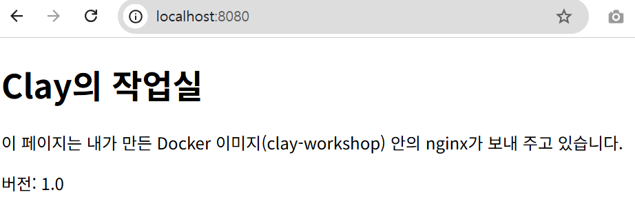

# Mission 01 · 내 컴퓨터에 개발자용 '작업실' 꾸미기
> 한 줄 요약: 터미널·Docker·Git을 직접 설치하고 다뤄, 누가 실행해도 같은 결과가 나오는 개발 작업실(워크스테이션)을 만든 기록

> [!NOTE]
> 코디세이 AI 올인원 1기 · 1주차 · 상태: 평가 대기

## 무엇을 했나
- 리눅스 터미널로 파일·폴더·권한을 다루고, Docker로 컨테이너를 실행·관리한다.
- 직접 쓴 Dockerfile로 웹 서버 이미지를 만들고, 포트 매핑·바인드 마운트·볼륨을 실행 결과로 검증한다.
- Git·GitHub로 작업 기록을 관리한다.
- 결과 화면: 내가 만든 이미지로 띄운 웹 서버에 브라우저로 접속 (`-p 8080:8080`)

  

## 실행 환경
| 항목 | 값 |
|---|---|
| OS | Windows 10.0.26300.9974 + WSL 3.0.5 (커널 6.18.58.1) · Ubuntu 26.04.1 LTS |
| 셸·터미널 | 실습: Ubuntu bash 5.3.9 / Git: PowerShell (Cursor 터미널) → [이유](LEARNING.md#4-git은-powershell-실습은-ubuntu-bash) |
| Docker | Docker Desktop · Docker 29.9.3 (WSL 2 백엔드, Ubuntu WSL integration 켬) |
| Git | 2.54.0.windows.1 |
| 편집기 | Cursor (VSCode 기반) → [이유](LEARNING.md#2-편집기는-vscode-대신-cursor) |

## 실행 방법
```bash
git clone https://github.com/Clay-pieup/Codyssey_AIO_Mission_01.git
cd Codyssey_AIO_Mission_01
docker build -t clay-workshop:1.0 .
docker run -d --name web -p 8080:8080 clay-workshop:1.0   # 브라우저에서 http://localhost:8080
```
<details><summary>바인드 마운트·볼륨까지 따라 하기</summary>

```bash
cp -r app ~/workshop/site
docker run -d --name bind -p 8082:8080 -v "$HOME/workshop/site:/usr/share/nginx/html" clay-workshop:1.0
docker volume create clay-data
docker run -d --name vol-1 -v clay-data:/data alpine:3.20 sleep 3600
docker exec vol-1 sh -c 'echo "saved" > /data/note.txt'
docker rm -f vol-1
docker run -d --name vol-2 -v clay-data:/data alpine:3.20 sleep 3600
docker exec vol-2 cat /data/note.txt     # saved
```
</details>

**내 PC에만 해당하는 설정 (따라 할 때 주의)**
- Windows에서는 Docker Desktop의 WSL integration을 켜야 Ubuntu에서 `docker`가 엔진에 연결된다 → [시행착오 5](LEARNING.md#5-docker-명령마다-failed-to-connect-to-the-docker-api-at-npipe)
- 실습 폴더 `~/workshop`은 저장소 밖 Ubuntu 홈에 있다. 포트 8080·8081·8082가 비어 있어야 한다.

## 검증 방법
| 항목 | 명령 | 확인한 결과 | 증거 |
|---|---|---|---|
| 터미널·경로 | `pwd` `ls -la` `cp` `mv` `rm` | 숨김 파일 보임, 이동·삭제 반영 | [U3](LEARNING.md#u3--터미널-조작-로그) |
| 권한 | `chmod` `stat -c '%a %A'` | 644→755, 755→700, 거부 확인 | [U4](LEARNING.md#u4--권한-실습) |
| Docker 점검·운영 | `docker --version` `info` `ps -a` `logs` `stats` | 29.9.3, 실행·중지·로그 확인 | [U5](LEARNING.md#u5--docker-점검기본-운영-명령) |
| 컨테이너 진입 | `docker run -it` `attach` `exec` | attach는 나가면 멈춤, exec는 계속 | [U6](LEARNING.md#u6--ubuntu-컨테이너attachexec-관찰) |
| 커스텀 이미지 | `docker build` `docker ps` | `(healthy)`, `X-Workshop: clay-m01` | [U7](LEARNING.md#u7--dockerfile-커스텀-이미지) |
| 포트·바인드 마운트 | `-p 8080:8080` `-v 폴더:…` | 200 OK, 1.0→1.1 바로 반영 | [U8](LEARNING.md#u8--포트-매핑-접속바인드-마운트) |
| 볼륨 | `docker volume create` `-v clay-data:/data` | 삭제 후 새 컨테이너에서 같은 메모 | [U9](LEARNING.md#u9--볼륨-영속성) |
| Git·GitHub 연동 | `git config --list` · Cursor 계정 | 이름·noreply·main, GitHub 로그인 | [U2](LEARNING.md#u2--git-설정저장소-만들기) · [U10](LEARNING.md#u10--편집기-연동보안재현성-점검) |

## 체크리스트
**필수 (완료 13/13)**
| # | 항목 | 상태 | 증거·해설 |
|---|---|---|---|
| 1 | 공개 저장소 + README 기본 구성 | ✅ 완료 | 이 README (실행 환경·검증 방법) |
| 2 | 터미널 조작 로그 | ✅ 완료 | [수행 로그](LEARNING.md#u3--터미널-조작-로그) |
| 3 | 권한 실습 | ✅ 완료 | [수행 로그](LEARNING.md#u4--권한-실습) |
| 4 | Docker 설치·점검 | ✅ 완료 | [수행 로그](LEARNING.md#u5--docker-점검기본-운영-명령) |
| 5 | Docker 기본 운영 명령 | ✅ 완료 | [수행 로그](LEARNING.md#u5--docker-점검기본-운영-명령) |
| 6 | 컨테이너 실행 실습 (hello-world·ubuntu·attach/exec) | ✅ 완료 | [U5](LEARNING.md#u5--docker-점검기본-운영-명령) · [U6](LEARNING.md#u6--ubuntu-컨테이너attachexec-관찰) |
| 7 | Dockerfile 커스텀 이미지 | ✅ 완료 | [코드 해설](LEARNING.md#핵심-코드-해설) · [수행 로그](LEARNING.md#u7--dockerfile-커스텀-이미지) |
| 8 | 포트 매핑 접속 증거 | ✅ 완료 | [수행 로그·스크린샷](LEARNING.md#u8--포트-매핑-접속바인드-마운트) |
| 9 | 바인드 마운트 반영 | ✅ 완료 | [전·후 비교](LEARNING.md#u8--포트-매핑-접속바인드-마운트) |
| 10 | 볼륨 영속성 | ✅ 완료 | [수행 로그](LEARNING.md#u9--볼륨-영속성) |
| 11 | Git 설정 + GitHub·편집기 연동 | ✅ 완료 | [U2 설정](LEARNING.md#u2--git-설정저장소-만들기) · [U10 Cursor 연동](LEARNING.md#u10--편집기-연동보안재현성-점검) |
| 12 | 트러블슈팅 2건 이상 | ✅ 완료 | [시행착오 6건](LEARNING.md#시행착오) |
| 13 | 보안·재현성 점검 | ✅ 완료 | [U10 점검](LEARNING.md#u10--편집기-연동보안재현성-점검) |

**보너스 (완료 0/5)**: Compose 기초 · Compose 멀티 컨테이너 · Compose 운영 명령어 · 환경 변수 활용 · GitHub SSH 키 (모두 ⬜ 대기)

## 진행 기록
### 2026-11-26 · 주중 세션
- U11 추가: 발표 슬라이드 15장(쉬운 말, 시연 순서 포함), `docs/slides.pdf` · 변경: 상태 평가 대기
- U10 추가: 실행 환경 버전, 검증 방법 표, Cursor GitHub 연동 스크린샷, 보안·재현성 점검 · 변경: 필수 1·11·12·13 완료 (13/13)
- U8·U9 추가: 포트 매핑(8080·8081)·바인드 마운트 전·후 비교(스크린샷 2장), 볼륨 영속성 · 변경: 필수 8·9·10 완료
- U7 추가: Dockerfile·.dockerignore, 빌드·실행 healthy · 변경: 필수 7 완료 · 수정: U7 파일은 U6 커밋(d5a993d)에 먼저 들어감
- U5·U6 추가: Docker 점검·운영 명령, ubuntu 진입·attach/exec 관찰, 트러블슈팅 4·5 · 변경: 필수 4·5·6 완료 · 수정: WSL integration 켬

<details><summary>이전 기록</summary>

- 11-25 U4 추가: 권한 실습(파일 644→755, 폴더 755→700), 트러블슈팅 3 · 변경: 필수 3 완료
- 11-25 U3 추가: 터미널 조작 로그(절대/상대 경로 포함) · 변경: 필수 2 완료
- 11-25 U2 추가: Public 저장소, 뼈대 파일, 첫 커밋·push, `git config` 기록, 트러블슈팅 1·2 · 변경: 브랜치는 main 하나로
- 11-15 U1 추가: WSL2 Ubuntu + Docker Desktop 설치, 편집기 Cursor로 결정

</details>

## 더 보기
- [학습 기록](LEARNING.md) — 설계 결정 · 핵심 코드 해설 · 수행 로그 · 시행착오(트러블슈팅 6건) · 배운 점 · 용어 사전
- 발표 슬라이드: [PDF](docs/slides.pdf) · [온라인 보기](https://claude.ai/artifact/5rnQfyb18TUmjcvFKHphei) — 평가 기준 5가지 순서 + 배운 점 + 시연 순서 (15장) · 스크린샷: [`images/`](images/)
